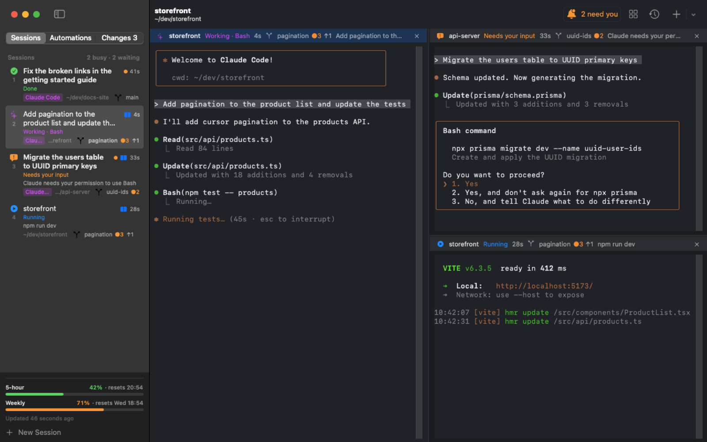

# Patchbay

A Mac app for running several Claude Code sessions (and Codex, Gemini, other agents and plain shells) side by side,
with a sidebar that shows what each one is doing.



- **Sidebar**: every session with its status (*Working · Bash*, *Waiting for agent*, *Needs your input*, *Done*,
  *Running `npm test`*, *Idle*) and how long it's been in that state. Agent sessions are titled by your last
  prompt (or the name you chose), with the question the agent is asking, if any, and the folder below. Drag to
  reorder, right-click to rename / open a sibling shell / show in Finder.
- **Groups and bulk selection**: ⌘-click or ⇧-click sessions in the sidebar to select several, then right-click
  to open them as an even grid of panes, move them to a group, or close them all. Groups are named, collapsible
  sidebar sections (right-click a session → *Move to Group* → *New Group…*); drag a session into one to move it
  there, right-click a group's header to rename it, open or close all its sessions, or ungroup it. A group goes
  away when its last session leaves.
- **Git state**: the folder line also shows the branch, changed files (`●3`) and commits ahead / behind
  (`↑1 ↓2`), in the sidebar, pane headers and overview cards.
- **Changes**: the *Changes* tab in the sidebar is source control for the focused session's repository: stage,
  unstage, discard (asks first) and commit (⌘↩). Click a file to see its diff beside the panes. Click a line
  number (⇧-click for a range) to comment for the agent; *Send to Agent* types all comments into the session as
  one message, without pressing Return. ⌘F searches the diff. *Edit* (or clicking a hunk header) opens the file
  itself, highlighted, with line numbers; new and changed lines are tinted green and removed ones marked red as you
  type. ⌘F there opens find and replace; ⌘S saves, and leaving the file saves it too. Without unsaved edits it
  follows the file on disk, so an agent's changes show up.
- **Worktrees**: in a git repository, ⌘N can start the session in a new worktree (a second checkout on its own
  branch, in `~/.patchbay/worktrees/<repo>/<branch>`), so several agents can work on one repository without
  getting in each other's way. The branch is named after the session; naming an existing branch checks it out.
  Right-click a session → *New Worktree Session…* does the same for its repository. Sessions in a worktree show
  its branch with a dashed icon. Closing the last session in one, alone or among several selected, asks whether
  to delete the worktree too (its branch is kept if it has unmerged commits).
  A new worktree lacks gitignored files. A `.patchbay.json` in the repository can copy them over and run a
  setup command before the agent starts; the sheet shows both before you start:
  ```json
  { "copy": [".env", "config/local.json"], "setup": "npm install" }
  ```
- **Split panes**: drag a session from the sidebar (or a pane by its title bar) onto a pane: an edge splits,
  the centre swaps. Drag the dividers to resize (double-click to even out). The × on a pane removes it from the
  screen while the session keeps running.
- **Overview** (⇧⌘O): every session as a live terminal card in a grid. Drag the gaps to resize, pick the number
  of columns in the toolbar. Cards needing you have an orange border. Double-click a header to open it in the panes.
- **Bring in Claude sessions from other terminals**: sessions running in Terminal, iTerm etc. are listed under
  *Claude in Other Terminals*. Drag one onto a pane or into the session list, or click its arrow: Claude quits
  there and the same conversation resumes here (`claude --resume`, keeping options like `--model`). A running
  process can't be moved between apps, so a task in progress is interrupted (you're asked first).
- **Drop from Finder**: a folder dropped on the sidebar opens a session there, on a pane's edge a split. Files
  dropped on a pane are typed in as escaped paths.
- **Claude usage**: bars at the bottom of the sidebar for your plan's 5-hour and weekly limits, with reset times
  (Pro/Max only). Claude Code only hands these numbers to its status line, so point `statusLine` in
  `~/.claude/settings.json` at the app's `statusline.sh`.
- **History** (⇧⌘H): a searchable timeline by day of prompts, finished turns, shell commands with exit code and
  duration, and sessions opened, closed or moved in. Jump to a session, resume a closed conversation or run a
  command again. Kept in `~/Library/Application Support/Patchbay/history.jsonl`, 90 days by default (Settings).
- **Attention**: sessions that need input or finished while you weren't looking get an orange dot, a dock badge
  and a notification; ⌘J jumps to the next one. Long shell commands (>10 s) finishing in the background count too.
- **Permission requests**: an agent asking to run a tool shows *Asks permission* and, for Claude, the request
  itself (*Bash: npm test*). Allow and Deny on the sidebar row or overview card, or ⌘Y / ⇧⌘Y for the selected
  session, type the agent's own answer keys into its terminal, where you can still answer any other way.
- **Agents directing agents**: Claude in Patchbay's terminals gets Patchbay's own MCP tools, so you can ask one
  session to split work across others: *"start three Claude sessions on branches fix-a, fix-b and fix-c, give
  each one of these bugs, and tell me when they're done"*. The tools list sessions, read their output, start
  agents (optionally in a new worktree), type into them, wait until they're done and close them, and list,
  create and delete automations (*"review my open PRs every weekday at 9"*). Sessions it
  starts join its sidebar group (a group named after it if it had none) and don't take your focus. It can type
  into and close only the sessions it started, and leaves their permission prompts to you. Looking around
  needs no permission; starting, typing, closing and creating or deleting automations ask, as Claude's tools do.
  Off in Settings.
- **Automations**: the *Automations* tab in the sidebar starts a session on a schedule (hourly, daily, on weekdays
  or weekly): an agent with a prompt, such as *"review yesterday's commits"*, or a shell running a command, in a
  folder or in a new worktree for each run. Each automation's runs collect in a sidebar group named after it, and
  notify you like any session when they finish or need you. A run is skipped while the last one is still busy.
  Automations run only while Patchbay is open; a run missed while it was closed or the Mac slept starts once it's
  back. Right-click one to run it now, edit it or show its last run.
- **Restore**: on relaunch the pane layout, folders and Claude conversations come back. Both can be turned off
  in Settings (⌘,).

## Build & install

Requires macOS 15+ and Xcode (Swift 6).

```sh
./build.sh            # builds build/Patchbay.app
./build.sh --install  # also copies it to ~/Applications and opens it
```

You can also open `Package.swift` in Xcode.

## Shortcuts

| | |
|---|---|
| ⌘N | New session… (folder, name, shell or agent, optional first prompt) |
| ⌘T | New shell in the current session's folder |
| ⌘W | Close session (asks if an agent or a command is still running) |
| ⌘1…⌘9, ⇧⌘] / ⇧⌘[ | Switch sessions |
| ⌘J | Next session that needs you |
| ⌘Y / ⇧⌘Y | Allow / deny the selected session's permission request |
| ⌘D / ⇧⌘D | Split right / down (new shell in the same folder) |
| ⌘] / ⌘[ | Next / previous pane |
| ⌥⌘W | Remove pane (session keeps running) |
| ⌃⌘= | Even out panes |
| ⇧⌘O | Toggle overview |
| ⇧⌘H | Toggle history |
| ⌘R | Rename session |
| ⌘= / ⌘- / ⌘0 | Font size |

## How status tracking works

Nothing in your own config is modified. The app keeps its files in `~/Library/Application Support/Patchbay/`:

- `zsh/`: a `ZDOTDIR` wrapper. Each session's zsh loads your own startup files unchanged, then adds hooks that
  report the running command, exit code and directory, and a `claude` function that adds
  `--settings claude-settings.json`.
- `claude-settings.json`: Claude Code hooks (`SessionStart`, `UserPromptSubmit`, `Pre/PostToolUse`,
  `Notification`, `Stop`, `SessionEnd`), merged by Claude with your own settings.
- `claude-hook.sh`: what each hook runs. It appends the event to `events/<session>.events`, which the app reads.
- `statusline.sh`: the status line mentioned under *Claude usage*; also saves the usage numbers for the app.

Esc/Ctrl-C in Claude fires no hook, so a "working" session whose screen is silent for 8 s is shown as waiting
for a prompt again (unless a subagent is running: *Waiting for agent*).

Other agents: Codex and Gemini are built in, and Settings → Other agents adds any command. They have no hooks, so
they show *Working* while output flows and *Waiting for prompt* after 8 s of silence. When their output pauses,
the screen is searched for the agent's permission prompt text (set per agent in Settings; Codex's and Gemini's
defaults are untested). Reopened sessions restart them fresh.

Limitations: the integration is zsh-only (other shells get a plain terminal). A `claude` alias keeps working:
the wrapper runs the alias's command with the app's settings added.

Terminal emulation is [SwiftTerm](https://github.com/migueldeicaza/SwiftTerm).
